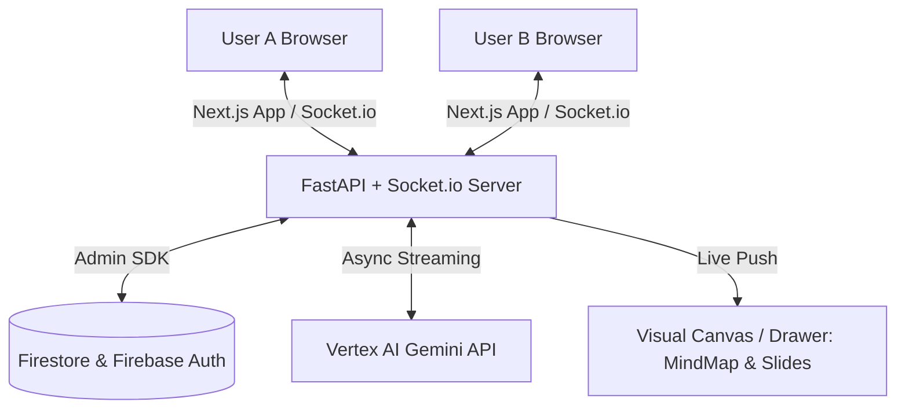

# 🧠 CollabMind

> **Real-Time Collaborative Brainstorming Workspace Powered by Multi-Agent AI**

CollabMind brings distributed teams together into an ultra-fast, interactive workspace. Teammates can chat in real-time, collaborate synchronously, and summon specialized AI agents via `@mentions` to generate dynamic **Mermaid.js mind maps**, structured **presentation slide decks**, code blueprints, and executive summaries on the fly.

---

## 🏗️ Architecture Overview



- **Frontend**: Next.js 14 App Router (TypeScript, Tailwind CSS, Lucide icons, Mermaid.js dynamic rendering).
- **Backend**: Python FastAPI with mounted `python-socketio` ASGI server for bi-directional streaming.
- **AI Engine**: Google Cloud Vertex AI (Gemini 1.5) with streaming tokens and local fallback simulation.
- **Database & Auth**: Firebase Authentication & Firestore (with security rules & composite indexing).
- **Deployment**: Google Cloud Run containerized via Docker.

---

## 📁 Repository Directory Structure

```text
collabmind/
├── frontend/                  # Next.js (TypeScript, Tailwind)
│   ├── src/
│   │   ├── app/               # Next.js App Router pages
│   │   │   ├── (auth)/        # Login / Register pages
│   │   │   ├── chat/[id]/     # Dynamic chat room route
│   │   │   ├── layout.tsx     # Global layout & providers
│   │   │   └── page.tsx       # Workspace dashboard & room launcher
│   │   ├── components/        # Reusable UI components
│   │   │   ├── chat/          # MessageBubble, ChatInput
│   │   │   ├── agents/        # SlideOverWindow, AgentTypingIndicator
│   │   │   └── visuals/       # MindMapRenderer (Mermaid), SlidePreview
│   │   ├── lib/               # Shared utilities & configurations
│   │   │   ├── firebase.ts    # Firebase client SDK initialization
│   │   │   └── socket.ts      # Socket.io client instance
│   │   └── hooks/             # Custom React hooks
│   │       ├── useAuth.ts     # Firebase auth state listener & guest sessions
│   │       └── useChat.ts     # Merges Firestore history with Socket.io live events
│   ├── package.json
│   ├── tsconfig.json
│   └── tailwind.config.ts
│
├── backend/                   # Python FastAPI
│   ├── app/
│   │   ├── __init__.py
│   │   ├── main.py            # FastAPI app init & Socket.io server mount
│   │   ├── core/              # Core settings and configurations
│   │   │   ├── config.py      # Environment variables & Pydantic settings
│   │   │   └── firebase.py    # Firebase Admin SDK initialization
│   │   ├── api/               # Standard REST endpoints
│   │   │   └── routes.py
│   │   ├── sockets/           # WebSocket / Socket.io logic
│   │   │   ├── events.py      # Socket event listeners (@mentions, typing, presence)
│   │   │   └── room_mgr.py    # Managing connected users per chat room
│   │   └── agents/            # AI Integration logic
│   │       ├── router.py      # Intercepts @ commands and routes to correct agent
│   │       ├── prompts.py     # System instructions for @ppt-maker, @mindmap, etc.
│   │       └── executor.py    # Vertex AI API streaming logic
│   ├── requirements.txt
│   └── Dockerfile             # Container configuration for Google Cloud Run
│
├── firebase/                  # Firebase configurations
│   ├── firestore.rules        # Security rules for database access
│   └── firestore.indexes.json # Database indexing for chat queries
│
├── .gitignore
└── README.md
```

---

## ⚡ Quickstart & Local Development

### 1. Backend Setup (FastAPI + Socket.io)

```bash
cd backend

# Create and activate virtual environment
python -m venv venv
# Windows:
venv\Scripts\activate
# macOS/Linux:
# source venv/bin/activate

# Install dependencies
pip install -r requirements.txt

# (Optional) Copy environment file
cp .env.example .env

# Start ASGI server with hot reloading
uvicorn app.main:socket_app --host 0.0.0.0 --port 8080 --reload
```

Backend will be running on `http://localhost:8080`.  
Visit `http://localhost:8080/docs` to inspect interactive OpenAPI documentation.

### 2. Frontend Setup (Next.js)

```bash
cd frontend

# Install dependencies
npm install

# (Optional) Copy environment file
cp .env.example .env.local

# Run Next.js development server
npm run dev
```

Frontend will be running on `http://localhost:3000`.

---

## 🤖 Supported Agent Mentions

Type any of the following tags in the chat input or use the quick mention buttons:

| Tag | Name | Description | Output Artifact |
|---|---|---|---|
| `@mindmap` | **Mind Map Generator** | Analyzes chat ideas and produces zoomable Mermaid node charts. | Interactive Mermaid SVG Canvas |
| `@ppt-maker` | **Slide Deck Creator** | Generates multi-slide decks with bullet points and speaker notes. | Interactive Slide Carousel |
| `@summarizer` | **Meeting Summarizer** | Produces executive summaries, decisions, and action items. | Markdown Summary |
| `@coder` | **Code Architect** | Generates system component designs, schemas, and implementations. | Formatted Code Blocks |

---

## 🚀 Google Cloud Run Deployment

Build and deploy the backend directly to Google Cloud Run:

```bash
cd backend

# Build and submit container image with Cloud Build
gcloud builds submit --tag gcr.io/[PROJECT_ID]/collabmind-backend

# Deploy to Cloud Run
gcloud run deploy collabmind-backend \
  --image gcr.io/[PROJECT_ID]/collabmind-backend \
  --platform managed \
  --region us-central1 \
  --allow-unauthenticated \
  --set-env-vars GCP_PROJECT_ID=[PROJECT_ID],VERTEX_AI_LOCATION=us-central1
```

---

## 🔐 Firebase Security Rules Deployment

Deploy Firestore rules and composite indexes using the Firebase CLI:

```bash
cd firebase
firebase deploy --only firestore:rules,firestore:indexes
```
